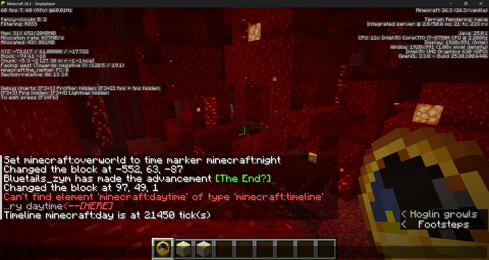
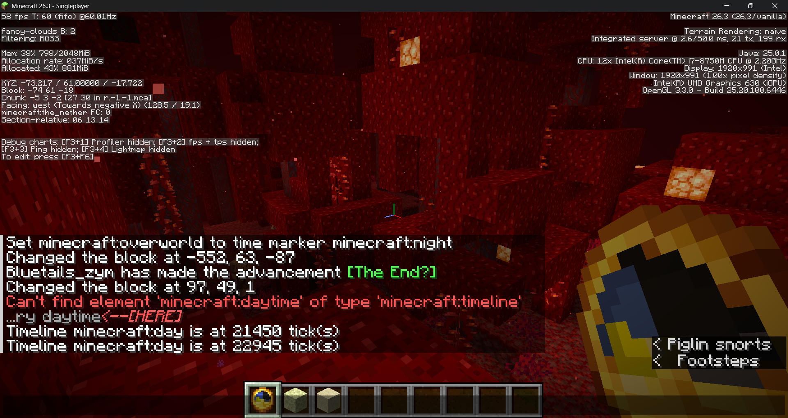
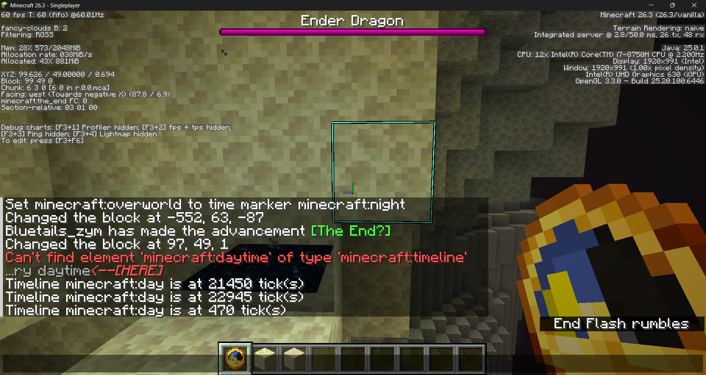
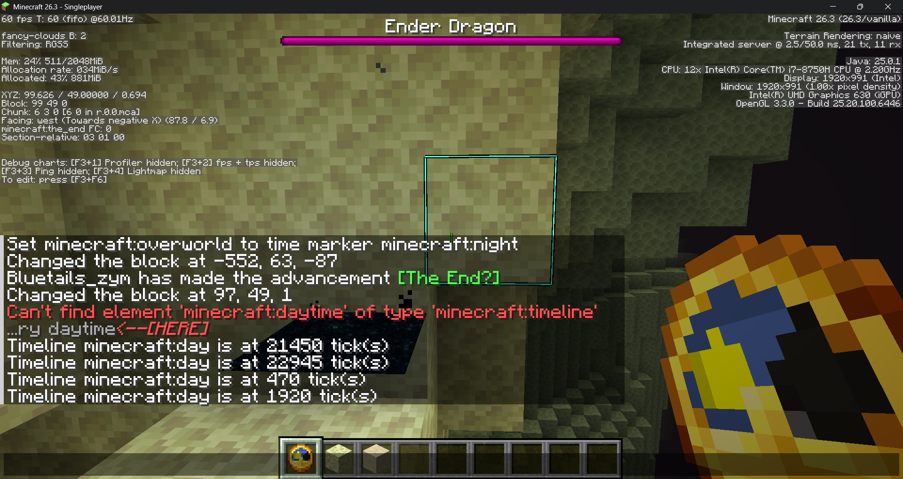

# Nether & End Clock

Makes the **clock** item work in the Nether and the End for Minecraft Java Edition **26.3**.

Instead of spinning randomly, the clock shows the **Overworld's time**, live. It keeps moving while you're away, so you can tell when it's getting dark back home.

## Screenshots

Holding the clock in each dimension, with `/time of minecraft:overworld query minecraft:day` run about a minute apart. The Overworld's time keeps moving and the dial follows it.

| | Before | About a minute later |
| --- | --- | --- |
| **Nether** |  |  |
| **End** |  |  |

## What's included

You need **both** packs:

| Pack | Folder | What it does |
| --- | --- | --- |
| Data pack | `datapack/` | Adds a timeline driven by the Overworld clock that sets the sun angle in the Nether and End |
| Resource pack | `resourcepack/` | Lets the clock item model use the time in the Nether and End, not only the Overworld |

Ready-to-use zips are on the [Releases](../../releases) page.

## Install

1. **Data pack:** put `NetherEndClock_datapack.zip` in your world's `datapacks` folder
   (in game: select the world → Edit → Open World Folder → `datapacks`).
2. **Resource pack:** put `NetherEndClock_resourcepack.zip` in your `resourcepacks` folder and turn it on in Options → Resource Packs.
3. **Save & Quit, then reopen the world.** `/reload` is not enough, because timelines only load when the world loads.

Check it's on with `/datapack list`.

## How it works

In 26.3 the clock's dial reads the `minecraft:visual/sun_angle` environment attribute. The Nether and End don't set it, and vanilla's clock model only uses the real time in the Overworld (everywhere else it spins randomly).

- The data pack adds `nether_end_clock:clock_sun`, a timeline on the `minecraft:overworld` world clock with only a `sun_angle` track (copied from vanilla's `minecraft:day`). It's appended to the `#minecraft:in_nether` and `#minecraft:in_end` timeline tags, so no vanilla files are replaced. `sun_angle` only affects sky rendering, and the Nether has no sky while the End sky doesn't draw a sun, so nothing else changes visually.
- The resource pack's `assets/minecraft/items/clock.json` is vanilla's, with `minecraft:the_nether` and `minecraft:the_end` added to the Overworld case.

Clocks in custom or modded dimensions still spin as normal.

## Compatibility

| Minecraft Java | Status |
| --- | --- |
| **26.3** | ✅ Tested |
| **26.1 – 26.2.x** | ✅ Should work (untested). The game files this relies on are identical to 26.3's |
| **26.4 snapshots** | ✅ Should work (the files are still identical as of 26.4 Snapshot 4); you may need to click through an "incompatible" warning |
| **1.21.11** | ❌ Not supported. Timelines existed, but they weren't tied to the Overworld clock yet, so the trick doesn't carry over |
| **1.21.10 and older** | ❌ Not possible. Timelines and environment attributes don't exist yet, and the clock can't be changed with a data pack |

The packs need three things the game added in **26.1**: world clocks, timelines that run on a chosen clock (`minecraft:overworld`), and a clock dial that reads the `minecraft:visual/sun_angle` environment attribute. Pack formats cover data packs 101–121 and resource packs 84–97.

### If it breaks in a newer version

A future update could rename or change any of those parts. Signs it's broken:

- The clock spins randomly or points straight up (noon) in the Nether or End.
- The game log or `/reload` shows an error mentioning `nether_end_clock`.

If that happens, please [open an issue](../../issues) with your Minecraft version (and the error, if there is one), and I'll update the packs.

## Tip

`/time set day` doesn't work in the Nether (it has no default clock). Use `/time of minecraft:overworld set day` instead.

---

Made by [liangforstudy](https://github.com/liangforstudy), with help from Claude. Licensed under the [MIT License](LICENSE).
